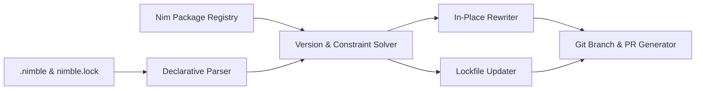

# renimble 👑

[](https://github.com/elijahr/renimble/actions/workflows/ci.yml)
[](https://nim-lang.org)
[](https://opensource.org/licenses/MIT)
[](https://github.com/marketplace/actions/renimble-nim-dependency-updater)

> **The definitive automated dependency updater for Nim projects.**  
> First-class `.nimble` and `nimble.lock` dependency tracking, automated version resolution, grouped pull requests, and GitHub Actions Marketplace integration.

---

## 🌟 Why Renimble?

GitHub Dependabot and Renovate lack native understanding of the Nim ecosystem:

| Feature | Dependabot | Renovate | **Renimble** |
|:---|:---:|:---:|:---:|
| **Native Pure-Nim Implementation** | ❌ | ❌ | ✅ |
| **All Nimble Operators** (`>`, `<`, `>=`, `<=`, `==`, `!=`, `&`, `^=`, `~=`) | ❌ | ⚠️ (Regex) | ✅ (AST/CST-level) |
| **Direct Git / HTTPS URLs** (`requires "https://github.com/..."`) | ❌ | ❌ | ✅ |
| **VCS Pins & Branches** (`#head`, `#master`, 40-char SHA pins) | ❌ | ❌ | ✅ |
| **Feature Flags** (`pkg[feature] >= 1.0`) | ❌ | ❌ | ✅ |
| **In-Place Comment & Task Block Preservation** | ❌ | ❌ | ✅ (Zero mangling) |
| **`nimble.lock` Lockfile Synchronization & Cycle Detection** | ❌ | ❌ | ✅ |
| **Atlas Workspace & `atlas.lock` Support** | ❌ | ❌ | ✅ |
| **Delegated Transitive Solver** (`nimble lock` / `atlas pin`) | ❌ | ❌ | ✅ (Graph-safe) |
| **Compiler Version Synchronization** (Actions, asdf, mise) | ❌ | ⚠️ | ✅ |
| **Serverless Closed PR Memory** (`<!-- renimble-metadata -->`) | ❌ | ✅ | ✅ (Zero repo state files) |
| **SemVer Interval Tree ($O(\log N + K)$ Range Algebra)** | ❌ | ❌ | ✅ |
| **Official Package Registry (`packages.json`) Indexing** | ❌ | ⚠️ | ✅ |
| **Grouped Pull Requests** | ✅ | ✅ | ✅ |

---

## 🚀 Quickstart: Add to Your Repository

### 1. Add Workflow
Create `.github/workflows/renimble.yml`:

```yaml
name: Renimble

on:
  schedule:
    - cron: '0 6 * * 1' # Every Monday at 06:00 UTC
  workflow_dispatch:

jobs:
  renimble:
    runs-on: ubuntu-latest
    permissions:
      contents: write
      pull-requests: write
    steps:
      - uses: actions/checkout@v4
      - uses: elijahr/renimble@v0.1
        with:
          github-token: ${{ secrets.GITHUB_TOKEN }}
```

### 2. Configure Renimble
Create `.github/renimble.yml`:

```yaml
version: 1
updates:
  - package-ecosystem: "nimble"
    directory: "/"
    target-branch: "main"
    schedule:
      interval: "weekly"

    # Optional: Group updates together
    groups:
      dev-dependencies:
        patterns:
          - "testutils"
          - "unittest2"

    commit-message:
      prefix: "chore(deps)"
      include: "scope"

    labels:
      - "dependencies"
      - "nim"

    # Optional: Keep Nim compiler version in sync across .nimble, workflows, & asdf/mise
    update-compiler-requirement: true
```

### 3. Add the Badge to Your Project
Show the world your Nim dependencies are kept fresh:

```markdown
[](https://github.com/elijahr/renimble)
```

---

## 🎯 Key Capabilities

### ⚡ Comprehensive Nimble & Atlas Support
* **Atlas Workspaces**: Native detection and parsing of `atlas.config` (`deps`, `nameOverrides`) and `atlas.lock`. Re-resolves pins via `atlas pin`.
* **Direct Git / HTTPS URLs**: Full support for requirements targeting raw URLs: `requires "https://github.com/nim-lang/zip.git >= 0.3.0"`.
* **Git Commit SHA Pins**: Automatically detects 40-character Git SHA pins (`#a1b2c3d4...`) and queries upstream remote HEADs to bump commit hashes.
* **Complex Range Algebra**: Point-stabbing and interval overlap queries powered by an internal SemVer Interval Tree, handling complex intersections (`>= 1.0.0 & <= 2.0.0 & != 1.5.0`).

### 🛡️ Transitive Lockfile Protection (Delegated Native Solver)
Naively patching top-level versions inside a lockfile corrupts transitive dependency trees. Like `cargo-edit`, `npm-check-updates`, and `uv`, `renimble` delegates lockfile synchronization to the official ecosystem solvers:
- For Nimble: Runs `nimble lock <package>` to compute clean transitive dependency graphs.
- For Atlas: Runs `atlas pin` to capture exact repository checkouts without version drift.

### 🧠 Serverless Dismissal Memory (Renovate Pattern)
Traditional tools require write access to commit state files (like `.renimble/dismissed.json`) to remember ignored versions. In modern CI/CD, GitHub tokens are read-only (`contents: read`) by default.
`renimble` solves this elegantly by embedding a hidden HTML metadata comment into every generated PR:
```html
<!-- renimble-metadata
{
  "proposals": [
    { "package": "zippy", "targetVersion": "0.11.0", "bumpType": "btMinor" }
  ]
}
-->
```
When a PR is closed without merging (or via `@renimble close`), `renimble` reads the closed PR metadata from the GitHub API and automatically suppresses future duplicate notifications for that exact version—**zero repository state files committed**.

### 🔄 Nim Compiler Synchronization
When `update-compiler-requirement: true` is configured, `renimble` keeps your compiler version synchronized across all project layers:
1. Manifest requirement: `requires "nim >= 2.2.0"` in `.nimble`.
2. GitHub Actions workflows: `nim-version: '2.2.0'` in `.github/workflows/*.yml`.
3. Local environment tools: `nim 2.2.0` in `.tool-versions` (asdf/mise) and `nim = "2.2.0"` in `.mise.toml`.

---

## 💻 CLI Usage

`renimble` is designed to be a transparent local developer tool as well as a headless CI robot:

```bash
# 1. Local Report (Default, Read-Only)
# Inspects .nimble and lockfiles; prints available updates without touching files or git
renimble

# 2. Local In-Place Update
# Updates .nimble in-place and re-resolves lockfiles via native solver ('nimble lock' / 'atlas pin')
# Leaves changes in your working tree for 'git diff' and 'nimble test' (zero git branches/commits)
renimble update

# 3. CI Gate Check
# Exits with code 1 if dependencies are outdated (ideal for pre-commit hooks or local CI)
renimble check

# 4. Automated CI Mode
# Runs full automated GitOps: creates isolated branches, commits, pushes, and opens PRs
renimble ci
```

### CLI Commands & Options
- `(none) / report`: Check for updates and display formatted report (default).
- `update / apply / -u`: Apply updates in-place in working tree (zero git commits).
- `check / -k`: Exit code 1 if updates found.
- `ci / --ci / -g`: Automated CI mode (enabled by default when `GITHUB_ACTIONS=true`).
- `-c, --config:<path>`: Specify custom configuration file (default: `.github/renimble.yml`).
- `-v, --version`: Print version information.
- `-h, --help`: Display CLI options.

---

## 🛠️ Architecture



- **`src/renimble/version.nim`**: SemVer parser, operator evaluator (`!=`, `^=`, `~=`, etc.), and constraint bounds updater mirroring Nimble's engine.
- **`src/renimble/declarative_parser.nim`**: Declarative `.nimble` parser extracting package requirements, metadata, and canonical package names.
- **`src/renimble/rewriter.nim`**: Non-destructive, comment-preserving in-place file mutator.
- **`src/renimble/interval_tree.nim`**: $O(\log N + K)$ point-stabbing and range overlap interval tree over SemVer bounds.
- **`src/renimble/lockfile.nim`**: JSON lockfile parser, SHA updater, and DFS cycle/dangling dependency detection.
- **`src/renimble/atlas.nim`**: Atlas workspace manager, `atlas.config` JSON reader, and `atlas.lock` pin serializer.
- **`src/renimble/solver.nim`**: Delegated ecosystem solver interface (`nimble lock` / `atlas pin`).
- **`src/renimble/dismissal.nim`**: Serverless dismissal memory and hidden PR metadata extractor.
- **`src/renimble/compiler.nim`**: Multi-target Nim compiler synchronization (Workflows, asdf, mise).
- **`src/renimble/registry.nim`**: Local cached indexer for `nim-lang/packages`.
- **`src/renimble/upstream.nim`**: VCS tag explorer and remote HEAD commit resolver using `git ls-remote`.
- **`src/renimble/engine.nim`**: Update decision engine, interval-backed ignore evaluation, and rule grouping.
- **`src/renimble/pr.nim`**: Git operations, branch creation, commit generator, and PR creation via `gh`.
- **`src/renimble/github_actions.nim`**: GitHub Actions runner adapter and step output broadcaster.

---

## 🧪 Testing

Run the test suite:
```bash
nimble test
# or
nim c -r --hints:off tests/test_all.nim
```

---

## 📄 License

MIT License. Engineered by [Axiomantic](https://github.com/axiomantic).
