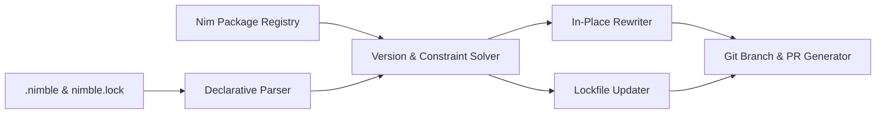

# renimble 👑

[](https://github.com/axiomantic/renimble/actions/workflows/ci.yml)
[](https://nim-lang.org)
[](https://opensource.org/licenses/MIT)
[](https://github.com/marketplace/actions/renimble-nim-dependency-updater)

> **The definitive automated dependency updater for Nim projects.**  
> First-class `.nimble` and `nimble.lock` dependency tracking, automated version resolution, grouped pull requests, and GitHub Actions Marketplace integration.

---

## 🌟 Why Renimble?

GitHub Dependabot and Renovate lack native understanding of the Nim ecosystem:

| Feature | Dependabot | Renovate | **Renimble** |
|:---|:---:|:---:|:---:|
| **Native Pure-Nim Implementation** | ❌ | ❌ | ✅ |
| **All Nimble Operators** (`>`, `<`, `>=`, `<=`, `==`, `&`, `^=`, `~=`) | ❌ | ⚠️ (Regex) | ✅ (AST/CST-level) |
| **VCS Pins & Branches** (`#head`, `#master`, SHA pins) | ❌ | ❌ | ✅ |
| **Feature Flags** (`pkg[feature] >= 1.0`) | ❌ | ❌ | ✅ |
| **In-Place Comment & Task Block Preservation** | ❌ | ❌ | ✅ (Zero mangling) |
| **`nimble.lock` Lockfile Synchronization & Cycle Detection** | ❌ | ❌ | ✅ |
| **SemVer Interval Tree ($O(\log N + K)$ Range Algebra)** | ❌ | ❌ | ✅ |
| **Official Package Registry (`packages.json`) Indexing** | ❌ | ⚠️ | ✅ |
| **Grouped Pull Requests** | ✅ | ✅ | ✅ |

---

## 🚀 Quickstart: Add to Your Repository

### 1. Add Workflow
Create `.github/workflows/renimble.yml`:

```yaml
name: Renimble

on:
  schedule:
    - cron: '0 6 * * 1' # Every Monday at 06:00 UTC
  workflow_dispatch:

jobs:
  renimble:
    runs-on: ubuntu-latest
    permissions:
      contents: write
      pull-requests: write
    steps:
      - uses: actions/checkout@v4
      - uses: axiomantic/renimble@v1
        with:
          github-token: ${{ secrets.GITHUB_TOKEN }}
```

### 2. Configure Renimble
Create `.github/renimble.yml`:

```yaml
version: 1
updates:
  - package-ecosystem: "nimble"
    directory: "/"
    target-branch: "main"
    schedule:
      interval: "weekly"

    # Optional: Group updates together
    groups:
      dev-dependencies:
        patterns:
          - "testutils"
          - "unittest2"

    commit-message:
      prefix: "chore(deps)"
      include: "scope"

    labels:
      - "dependencies"
      - "nim"
```

### 3. Add the Badge to Your Project
Show the world your Nim dependencies are kept fresh:

```markdown
[](https://github.com/axiomantic/renimble)
```

---

## 💻 CLI Usage

You can also run `renimble` locally or in custom CI scripts:

```bash
# Clone and build
git clone https://github.com/axiomantic/renimble
cd renimble
nimble buildRelease

# Run check in current directory
./bin/renimble --dry-run

# Run CI validation check (fails with exit code 1 if dependencies are outdated)
./bin/renimble --check
```

### CLI Options
- `-c, --config:<path>`: Specify custom configuration file (default: `.github/renimble.yml`).
- `-d, --dry-run`: Evaluate dependency updates and print report without modifying files or creating PRs.
- `-k, --check`: Exit with code 1 if any dependency updates are found (great for gating CI).
- `-g, --git`: Create git branch and commit changes for updates.
- `-v, --version`: Print version information.
- `-h, --help`: Display CLI options.

---

## 🛠️ Architecture



- **`src/renimble/version.nim`**: SemVer parser, operator evaluator, and constraint bounds updater mirroring Nimble's engine.
- **`src/renimble/declarative_parser.nim`**: Declarative `.nimble` parser extracting package requirements, metadata, and byte spans.
- **`src/renimble/rewriter.nim`**: Non-destructive, comment-preserving in-place file mutator.
- **`src/renimble/interval_tree.nim`**: $O(\log N + K)$ point-stabbing and range overlap interval tree over SemVer bounds.
- **`src/renimble/lockfile.nim`**: JSON lockfile parser, SHA updater, and DFS cycle/dangling dependency detection.
- **`src/renimble/registry.nim`**: Local cached indexer for `nim-lang/packages`.
- **`src/renimble/upstream.nim`**: VCS tag explorer using `git ls-remote` without local cloning.
- **`src/renimble/engine.nim`**: Update decision engine, interval-backed ignore evaluation, and rule grouping.
- **`src/renimble/pr.nim`**: Branch name, commit message, and PR markdown body generator.

---

## 🧪 Testing

Run the test suite:
```bash
nimble test
# or
nim c -r --hints:off tests/test_all.nim
```

---

## 📄 License

MIT License. Engineered by [Axiomantic](https://github.com/axiomantic).
