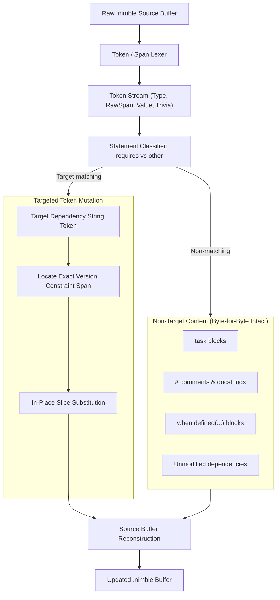
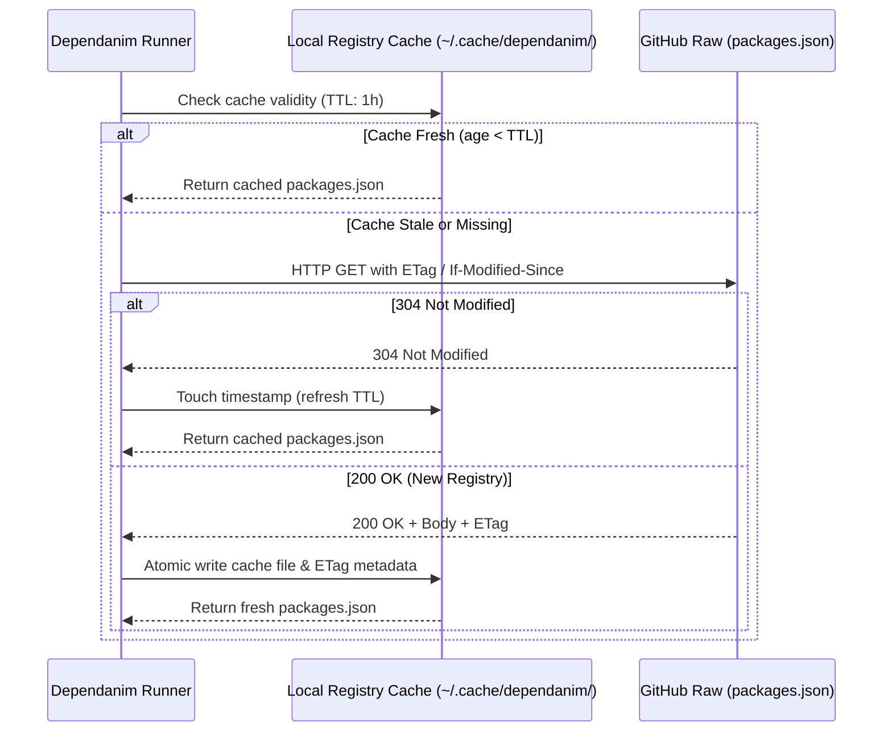
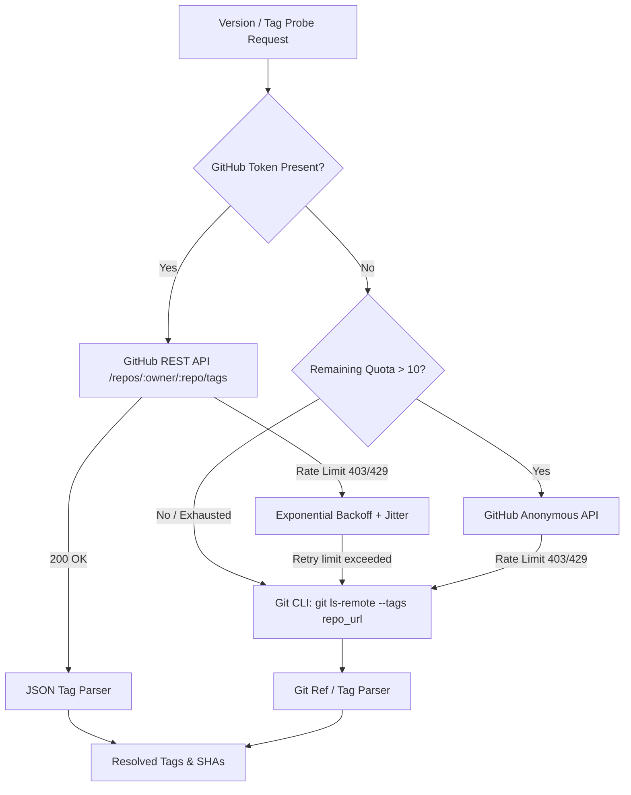
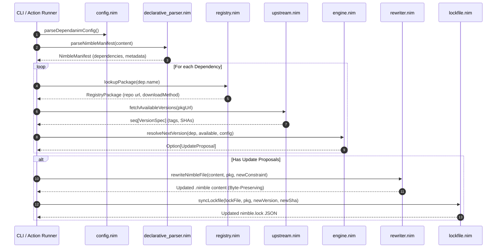

# RFD 001: Architectural Invariants, Rewriting Mechanics, and Constraint Resolution for Dependanim

**Author**: Kraken-Strand (`@dependanim-architect`), Staff Systems Architect  
**Status**: Ratified / Accepted  
**Created**: 2026-10-21  
**Target Subsystems**: `rewriter.nim`, `version.nim`, `lockfile.nim`, `registry.nim`, `upstream.nim`, `engine.nim`  
**Related Specifications**: [SPEC.md](file:///Users/eek/Development/dependanim/docs/SPEC.md)

---

## 1. Executive Summary & Architectural Scope

`dependanim` is an automated, native dependency updater for the Nim and Nimble ecosystem. Unlike general-purpose dependency tools that treat manifest files as arbitrary line collections or rely on destructive compiler AST round-tripping, `dependanim` must preserve human formatting intent while enforcing sound version constraint satisfaction.

This Request for Discussion (RFD) establishes the definitive architectural specifications and mathematical invariants for:
1. **Concrete Syntax Tree (CST) and Span-Based Rewriting vs Abstract Syntax Tree (AST)** for `.nimble` manifests.
2. **Constraint Graph Resolution Semantics and Transitive Lockfile (`nimble.lock`) Consistency**.
3. **Upstream VCS Rate Limiting, Registry Caching, and Air-Gapped / Offline Fallbacks**.

---

## 2. AST vs CST / Token-Based Rewriting Invariants for `.nimble` Files

### 2.1 The Failure of Compiler AST Parsing in `.nimble` Manipulation
A `.nimble` file is an executable Nim Script (`nims`) evaluated within the compiler VM or parsed into a compiler `PNode` AST via `compiler/parser`. While this enables dynamic logic such as task definitions (`task test, "run tests": ...`), using the standard Nim compiler AST for automated file modification fails fundamentally:
- **Loss of Trivia**: Standard compiler AST nodes strip non-semantic source elements: leading whitespace, indentation style (spaces vs tabs), blank lines, and line comments (`#`).
- **Destructive Serialization**: Re-serializing an altered compiler AST (`renderTree` or pretty-printing) completely rewrites the source file, destroying comments, reformatting custom macros, and converting user-crafted DSL layouts into normalized compiler syntax.
- **Dynamic Task Code Mutilation**: Tasks contain arbitrary Nim statements. A compiler parser may fail or require complex context definitions when encountering user-defined imports, helper procedures, or environment checks embedded inside `.nimble` files.

### 2.2 Concrete Syntax Tree (CST) and Token-Span Architecture
To guarantee zero collateral damage to manifest files, `dependanim` mandates a **CST / Span-Based Token Rewriter**.



### 2.3 Formal Rewriting Invariants
Every mutation to a `.nimble` file executed by `dependanim` must strictly uphold the following invariants:

1. **Invariant I1 (Non-Target Byte Invariance)**:
   For any file $S$ of byte length $N$ mutated to $S'$ by modifying a target package constraint located across byte span $[s_{start}, s_{end})$, all bytes preceding $s_{start}$ and succeeding $s_{end}$ must remain identical:
   $$\forall i \in [0, s_{start}), \quad S'[i] = S[i]$$
   $$\forall j \in [0, N - s_{end}), \quad S'[s_{start} + L_{new} + j] = S[s_{end} + j]$$
   where $L_{new}$ is the byte length of the replacement token.

2. **Invariant I2 (Quote Style Preservation)**:
   The quotation delimiter wrapping the dependency specification must never change. If the original source uses double quotes (`"pkg >= 1.0"`), double quotes must be preserved. If it uses single quotes (`'pkg >= 1.0'`) or triple quotes (`"""pkg >= 1.0"""`), the delimiter type and count must remain invariant.

3. **Invariant I3 (Whitespace & Indentation Immunity)**:
   Leading indentation, internal spacing between the `requires` keyword and argument expressions, spacing around commas, and trailing line terminators (LF vs CRLF) must remain byte-identical.

4. **Invariant I4 (Comment Immunity)**:
   Comments appearing before, after, or inline on the same line as a `requires` statement (e.g., `requires "zippy >= 0.10.0" # Performance critical decompression`) must never be stripped, truncated, or shifted unless required by the delta in version token length.

5. **Invariant I5 (Task Block & Executable Code Immunity)**:
   Blocks defined under `task <name>, "..."` or arbitrary procedural code must never be parsed, evaluated, or altered.

### 2.4 Grammar & Edge Case Coverage
The rewriter must handle all canonical `.nimble` dependency declarations:
- **Single Line, Single Requirement**:
  ```nim
  requires "nim >= 2.0.0"
  ```
- **Single Line, Multi-Package List**:
  ```nim
  requires "checksums >= 0.1.0", "zippy >= 0.10.4", "ws"
  ```
  *Requirement*: Upgrading `zippy` to `>= 0.11.0` must leave `"checksums >= 0.1.0"` and `"ws"` untouched within the same statement.
- **Multiline / Parenthesized Declarations**:
  ```nim
  requires(
    "nim >= 2.0.0",
    "chronos >= 4.0.0",
    "bearssl"
  )
  ```
- **Feature Flags**:
  ```nim
  requires "norm[sqlite] >= 2.2.0"
  ```
  *Requirement*: Updating the version must preserve the bracketed feature tag `[sqlite]`.
- **Conditional Target Guards**:
  ```nim
  when defined(windows):
    requires "winim >= 3.9.0"
  else:
    requires "posix_utils >= 0.1.0"
  ```
  *Requirement*: Branch guards must remain un-evaluated and intact.

---

## 3. Nimble SAT / Constraint Graph Resolution Semantics & Transitive Lockfile Consistency

### 3.1 Constraint Algebra and Operator Semantics
`dependanim` models version constraints over standard SemVer tuples:
$$V = (major, minor, patch, prerelease, build)$$

| Operator | Syntax Example | Meaning | Formal Semantics |
|---|---|---|---|
| **Exact** | `== 1.2.3` or `1.2.3` | Exact version match | $v = 1.2.3$ |
| **Greater Than** | `> 1.2.0` | Strictly greater | $v > 1.2.0$ |
| **Greater / Equal** | `>= 1.2.0` | Greater or equal | $v \ge 1.2.0$ |
| **Less Than** | `< 2.0.0` | Strictly less | $v < 2.0.0$ |
| **Less / Equal** | `<= 2.0.0` | Less or equal | $v \le 2.0.0$ |
| **Intersection** | `>= 1.2.0 & < 2.0.0` | Logical conjunction | $c_1(v) \land c_2(v)$ |
| **Caret** | `^= 1.2.3` | SemVer compatible bump | $\ge 1.2.3 \land < 2.0.0$ (for $major \ge 1$)<br>$\ge 0.2.3 \land < 0.3.0$ (for $major = 0, minor > 0$)<br>$\ge 0.0.3 \land < 0.0.4$ (for $major = 0, minor = 0$) |
| **Tilde** | `~= 1.2.3` | Patch-level updates only | $\ge 1.2.3 \land < 1.3.0$ |
| **VCS Head** | `#head` | Upstream default branch | Latest default branch commit SHA |
| **VCS Branch** | `#devel` | Specific branch | Latest named branch commit SHA |
| **VCS Commit** | `#9a38f3...` | Immutable commit pin | Specific commit SHA |

### 3.2 Constraint Satisfaction Problem (CSP) Formulation
Dependency resolution across a project and its transitive dependencies constitutes a Constraint Satisfaction Problem (CSP) defined over a Directed Acyclic Graph (DAG):
- Let $\mathcal{P} = \{P_1, P_2, \dots, P_n\}$ be the set of packages.
- Each package $P_i$ has a discrete finite domain $D(P_i) = \{v_{i,1}, v_{i,2}, \dots, v_{i,m}\}$ of published versions.
- A requirement $R(P_a, P_b, C)$ specifies that package $P_a$ requires package $P_b$ satisfying constraint $C$.

```mermaid
graph TD
    Root["Root Application (dependanim)"] -->|requires "A >= 1.0.0"| NodeA["Package A"]
    Root -->|requires "B >= 2.0.0"| NodeB["Package B"]
    NodeA -->|requires "C >= 1.5.0 & < 3.0.0"| NodeC["Package C"]
    NodeB -->|requires "C < 2.0.0"| NodeC
    
    subgraph Solution["SAT Intersection: D(C)"]
        Intersect["C in [1.5.0, 2.0.0)"]
    end
    NodeC --> Intersect
```

#### Conflict Detection & Unsolvability
When intersection results in the empty set $\emptyset$ (e.g. $P_a$ requires $P_c \ge 2.0.0$ and $P_b$ requires $P_c < 2.0.0$), `dependanim` must:
1. Halt resolution for the candidate version upgrade.
2. Generate an explicit diagnostic conflict path trace:
   `UnsatisfiableConstraintError: root -> A (1.2.0) -> C (>= 2.0.0) conflicts with root -> B (2.1.0) -> C (< 2.0.0)`.
3. Never emit an invalid or broken `.nimble` or `nimble.lock` state.

### 3.3 Resolution Strategies: MVS vs Greedy Upgrades
`dependanim` supports two deterministic resolution modes:
1. **Conservative (Default / CI Mode)**:
   - Evaluates only non-breaking updates within the operator's declared constraint range (e.g., matching `~=` or `^=`).
   - Prioritizes the highest compatible patch or minor release that satisfies all transitive constraints.
2. **Aggressive (Targeted Major Bump Mode)**:
   - Evaluates the global maximum published version $v_{max} \in D(P_i)$.
   - Relaxes root constraint in `.nimble` to allow $v_{max}$.
   - Resolves all transitive requirements for $v_{max}$ against the rest of the dependency graph.

### 3.4 Transitive Lockfile (`nimble.lock`) Consistency Invariants
Nimble's lockfile schema records the resolved state:
```json
{
  "version": 1,
  "packages": {
    "pkg_name": {
      "version": "1.2.3",
      "vcsRevision": "40_char_git_sha",
      "url": "https://github.com/org/repo",
      "downloadMethod": "git"
    }
  }
}
```

#### Lockfile Consistency Invariants:
1. **Invariant L1 (Immutable Commit Pinning)**:
   Every package entry in `nimble.lock` must specify an absolute, immutable 40-character Git commit SHA in `vcsRevision`. Floating references (`#head`, `#main`, tags) are strictly forbidden in lockfile storage.
2. **Invariant L2 (Transitive Closure Completeness)**:
   If package $P$ is locked at version $V$, every direct dependency $D \in \text{deps}(P, V)$ must also exist in `nimble.lock` with a valid, satisfying `version` and `vcsRevision`.
3. **Invariant L3 (Atomic Manifest-Lock Synchronization)**:
   Whenever `dependanim` updates a constraint in `.nimble`, the corresponding entry (and any transitively affected sub-dependencies) in `nimble.lock` must be recalculated and written simultaneously. A PR must never contain a modified `.nimble` without the corresponding synchronized `nimble.lock` (or vice-versa when a lockfile is tracked).

---

## 4. Upstream VCS Rate Limiting, Registry Caching, and Offline Fallback Mechanisms

### 4.1 Nimble Package Registry Architecture & Caching
Nimble maintains its global package registry via `packages.json` (canonical source: `https://raw.githubusercontent.com/nim-lang/packages/master/packages.json`).



#### Cache Invariants:
- **Location**: Storage defaults to `$XDG_CACHE_HOME/dependanim/packages.json` (fallback: `~/.cache/dependanim/packages.json` or `.dependanim/cache/packages.json`).
- **Atomic Cache Update**: To prevent corrupted reads during concurrent runner executions, writing the cached registry must write to a temporary file (`packages.json.tmp.<pid>`) and atomically rename (`renameFile`) over the target file.
- **Conditional Fetching**: HTTP requests for `packages.json` must always include `If-None-Match: <etag>` and `If-Modified-Since: <timestamp>` when cached metadata is present.

### 4.2 Upstream VCS Probing & Rate Limiting Mitigation
When querying upstream repositories for versions, tags, and commit SHAs, `dependanim` interacts with multiple VCS providers (GitHub, GitLab, Gitea, SourceHut).



#### 1. Rate Limit Token Bucket & Quota Tracking
- For GitHub API calls: Parse response headers `x-ratelimit-remaining`, `x-ratelimit-limit`, and `x-ratelimit-reset`.
- If `x-ratelimit-remaining < 5` and a valid reset timestamp exists, throttle outgoing calls or automatically switch to the Git CLI fallback.

#### 2. Exponential Backoff with Jitter
For transient 429 (Too Many Requests) or 503 (Service Unavailable) responses, the client must use truncated binary exponential backoff with full jitter:
$$t_{sleep} = \min\left(t_{max}, \, t_{base} \times 2^{attempt}\right) \times \text{rand}(0.5, 1.5)$$
where $t_{base} = 1.0\text{s}$, $t_{max} = 30.0\text{s}$, and maximum retry attempts $N_{max} = 3$.

#### 3. Zero-API Fallback via Git CLI
If upstream API credentials are unavailable or rate limits are exhausted, `dependanim` must fallback to the transport-level Git protocol:
```bash
git ls-remote --tags --heads <repository_url>
```
This requires zero API tokens, respects standard git credentials, and directly yields the complete mapping of ref names (tags, branches) to commit SHAs.

### 4.3 Air-Gapped and Offline Execution Mode
In restricted or air-gapped CI/CD environments where egress traffic is blocked:
1. **Offline Flag (`--offline`)**:
   When `--offline` is specified or `DEPENDANIM_OFFLINE=1` is set:
   - Network requests are strictly bypassed.
   - The engine relies exclusively on locally cached registry definitions and repository git object databases.
2. **Graceful Skip Protocol**:
   If an external dependency's upstream repository cannot be reached:
   - Do **NOT** crash or abort the entire update pipeline.
   - Emit a structured diagnostic warning: `[WARN] Failed to query upstream for package 'x': network offline. Skipping package.`
   - Continue processing the remaining dependencies in the manifest.

---

## 5. Subsystem Interface Contracts and Architectural Flow



---

## 6. Verification & Adversarial Audit Matrix

All implementations following this RFD must pass the following verification tests:

| Verification Target | Test Method | Acceptance Threshold |
|---|---|---|
| **Trivia & Whitespace Preservation** | Round-trip differential byte comparison on files with comments, tabs, and multi-arg requires | 100% byte equivalence outside target string span |
| **Constraint Soundness** | Truth-table assertion matrix across all SemVer operators (`<`, `<=`, `>`, `>=`, `==`, `&`, `^=`, `~=`) | Zero false positives/negatives against reference SemVer 2.0.0 |
| **Lockfile Immutability** | Validation of generated `nimble.lock` files | Every package contains 40-char SHA in `vcsRevision` |
| **Rate Limit Resilience** | Mock HTTP 429 and rate-exhaustion injection test | Clean fallback to `git ls-remote` without unhandled exception |
| **Offline Integrity** | Execution with simulated network failure | Graceful skip of unresolvable remotes, zero crashes |

---

## 7. Ratification Sign-off

- **Staff Systems Architect**: `@dependanim-architect` (Kraken-Strand) — *Approved*
- **Target Strand**: `strand/task-rfd-architecture`
