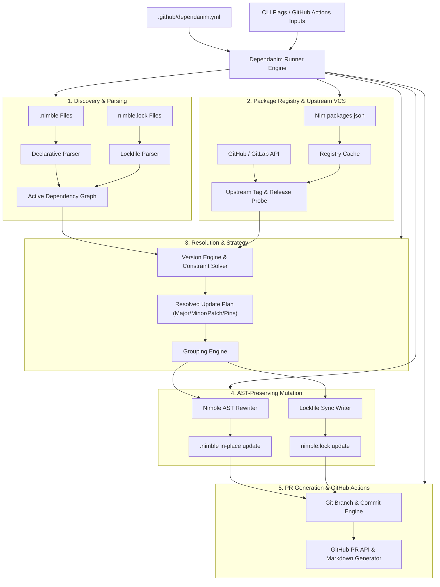

# Dependanim: Core Technical Specification
**Organization**: `axiomantic`  
**Repository**: `dependanim`  
**License**: MIT  
**Language**: Nim (>= 2.0.0)

---

## 1. Executive Summary & Problem Statement

Modern CI/CD pipelines rely on automated dependency updaters like GitHub Dependabot and Renovate to keep dependencies secure and up-to-date. However:
1. **GitHub Dependabot** has zero native support for the Nim programming language or Nimble packages.
2. **Renovate** has only rudimentary regex-based heuristics for `.nimble` files, lacking comprehension of:
   - Nimble's full version constraint grammar (such as intersection `&`, caret `^=`, tilde `~=`, and feature flags `pkg[feature] >= 1.0`).
   - In-place AST-preserving file manipulation (regex replaces frequently mangle comments, task blocks, or formatting).
   - `nimble.lock` lockfile updating and git revision pinning.
   - The official Nim package registry (`packages.json`).

`dependanim` is the definitive automated dependency updater engineered natively in Nim for Nimble projects. It provides first-class `.nimble` parsing, AST-preserving in-place updates, `nimble.lock` synchronization, SemVer resolution, grouped Pull Requests, and a turnkey GitHub Actions Marketplace integration.

---

## 2. Architecture & Subsystem Decomposition



### Module Layout
```
src/
├── dependanim.nim                 # Main CLI entrypoint
└── dependanim/
    ├── types.nim                  # Core domain records & types
    ├── config.nim                 # .github/dependanim.yml parser
    ├── version.nim                # SemVer parser, operators, & constraint solver
    ├── declarative_parser.nim     # High-fidelity .nimble declarative parser
    ├── rewriter.nim               # Comment & formatting-preserving .nimble rewriter
    ├── lockfile.nim               # nimble.lock JSON parser & serializer
    ├── registry.nim               # Nim package registry indexer & local cache
    ├── upstream.nim               # VCS / Git / GitHub tag and release query
    ├── engine.nim                 # Dependency update resolution & group clustering
    ├── pr.nim                     # Git operations, commit styling, & PR formatting
    └── github_actions.nim         # GitHub Actions runner adapter & step summaries
```

---

## 3. Nimble Version & Constraint Engine (`version.nim`)

`dependanim` mirrors and strictly complies with `nim-lang/nimble`'s `version.nim` semantics.

### 3.1 Supported Constraint Operators
- **Comparison**:
  - `>` : Strictly greater than.
  - `<` : Strictly less than.
  - `>=` : Greater than or equal to.
  - `<=` : Less than or equal to.
  - `==` : Exact version match.
- **Intersection**:
  - `&` : Logical AND of constraints (e.g., `>= 1.2.0 & <= 1.5.0`).
- **Pessimistic / Range Operators**:
  - `^=` : Caret operator (compatible with version; allows changes that do not modify left-most non-zero digit).
  - `~=` : Tilde operator (allows patch-level changes if minor is specified, e.g. `~= 1.2.3` allows `< 1.3.0 & >= 1.2.3`).
- **VCS & Branch Pins**:
  - `#head` : Latest commit on default branch.
  - `#<branch>` : Latest commit on specified branch (e.g. `#master`, `#devel`).
  - `#<sha>` : Specific 40-character or abbreviated Git commit SHA pin.
- **Feature Flags**:
  - `pkg[feature] >= 1.0` : Sub-package or feature requirements.

### 3.2 SemVer Increment Calculation
Given current version $V_{curr}$ and latest discovered upstream version $V_{latest}$:
- **Major**: Breaking change ($V_{latest}.major > V_{curr}.major$).
- **Minor**: Backward-compatible feature ($V_{latest}.minor > V_{curr}.minor$).
- **Patch**: Backward-compatible bug fix ($V_{latest}.patch > V_{curr}.patch$).
- **VCS Bump**: SHA or branch update.

---

## 4. In-Place AST & Formatting Preservation (`rewriter.nim`)

A critical differentiator of `dependanim` is that it **does not destructively overwrite** `.nimble` files. Nimble package files are Nim scripts that often include:
- Custom comments (`# ...`) and docstrings
- Task blocks (`task test, "..."`, `task build, "..."`)
- Conditional logic (`when defined(windows): ...`)
- Specific formatting (tab vs 2-space indentation, single vs double quotes)

### Rewriting Rules:
1. **Token-Level Pinpointing**: Locate the exact byte offset of the target `requires` statement string literal.
2. **Span Replacement**: Replace only the version segment of the dependency string (e.g., `requires "zippy >= 0.10.4"` $\to$ `requires "zippy >= 0.11.0"`), leaving surrounding quotation styles, whitespace, and trailing comments untouched.
3. **Task Block Immunity**: Never evaluate or strip task definitions or compiler pragmas.

---

## 5. Lockfile Specification (`lockfile.nim`)

Nimble generates a `nimble.lock` file formatted as JSON when lockfile support is enabled.
Schema structure:
```json
{
  "version": 1,
  "packages": {
    "zippy": {
      "version": "0.11.0",
      "vcsRevision": "9a38f3...",
      "url": "https://github.com/guzba/zippy",
      "downloadMethod": "git"
    }
  }
}
```
`dependanim` automatically synchronizes `nimble.lock` alongside `.nimble` updates, fetching the exact Git commit SHA corresponding to the resolved release tag.

---

## 6. Configuration Schema (`.github/dependanim.yml`)

The configuration lives in `.github/dependanim.yml` or `.github/dependanim.yaml`:

```yaml
version: 1
updates:
  - package-ecosystem: "nimble"
    directory: "/"
    target-branch: "main"
    schedule:
      interval: "weekly"
      day: "monday"
      time: "06:00"
      timezone: "Etc/UTC"
    
    # Update grouping rules
    groups:
      dev-dependencies:
        patterns:
          - "testutils"
          - "unittest2"
      minor-and-patch:
        update-types:
          - "minor"
          - "patch"

    # Packages to ignore
    ignore:
      - dependency-name: "chronos"
        versions: [">= 4.0.0"]

    # PR customization
    commit-message:
      prefix: "chore(deps)"
      include: "scope"
    labels:
      - "dependencies"
      - "nim"
    reviewers:
      - "octocat"
    assignees:
      - "octocat"
    open-pull-requests-limit: 10
```

---

## 7. GitHub Actions Integration (`action.yml`)

`dependanim` is packaged as a composite GitHub Action and downloadable binary:
```yaml
name: 'Dependanim: Nim Dependency Updater'
description: 'Automated .nimble and nimble.lock dependency updater for Nim'
inputs:
  github-token:
    description: 'GitHub token for creating branches and opening pull requests'
    required: true
    default: ${{ github.token }}
  config-path:
    description: 'Path to dependanim configuration file'
    required: false
    default: '.github/dependanim.yml'
  dry-run:
    description: 'Perform dependency check without opening PRs'
    required: false
    default: 'false'
```

---

## 8. Verification & Quality Gates

The test suite enforces the **Three-Key Verification Standard**:
1. **Mechanical Gate**: Zero compiler errors under Nim 2.0 and 2.2 across Linux and macOS.
2. **Semantic Gate**: 100% passing tests for version constraints, range intersections, lockfile mutations, and edge-case syntax.
3. **Adversarial Gate**: Round-trip formatting audits ensuring byte-for-byte fidelity of untargeted `.nimble` lines.
