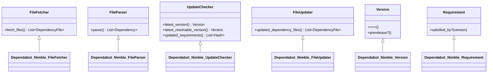

# New Ecosystem Request: Nim (Nimble & Atlas)

## Ecosystem Overview

| Field | Value |
| :--- | :--- |
| **Ecosystem name** | `nimble` |
| **Package manager(s)** | [Nimble](https://github.com/nim-lang/nimble) / [Atlas](https://github.com/nim-lang/atlas) |
| **Primary registry** | [Nim Package Directory (`packages.json`)](https://raw.githubusercontent.com/nim-lang/packages/master/packages.json) / [nimble.directory](https://nimble.directory) |
| **Manifest files** | `*.nimble`, `atlas.config` |
| **Lockfiles** | `nimble.lock` (JSON format v1), `atlas.lock` (JSON format) |

---

## Background & Tooling Architecture

[Nim](https://nim-lang.org/) is a statically typed, compiled systems programming language with clean syntax, expressive metaprogramming, and zero-overhead C/C++/JavaScript compilation targets.

### The Relationship Between Nimble and Atlas

A key architectural consideration in the Nim ecosystem is the relationship between **Nimble** and **Atlas**:

* **Nimble** is the official, standard package manager bundled with the Nim compiler since 2014. It specifies the canonical package manifest format (`<package>.nimble`), resolves dependencies against the central registry (`nim-lang/packages`), manages a global package cache in `~/.nimble/pkgs/` (and modern `~/.nimble/pkgs2/`), and (since v0.14) generates project-level `nimble.lock` files.
* **Atlas** is **not a divergent package manager or competing language ecosystem**; it is a **companion workspace cloner and monorepo orchestrator** developed by Andreas Rumpf (Nim's creator).
  * **Shared Manifest**: Atlas does not invent a new manifest format. It directly parses, consumes, and updates standard `*.nimble` files (`atlas use <pkg>` literally parses and patches the project's `.nimble` file).
  * **Shared Registry**: Atlas clones from the same Git repositories indexed in `nim-lang/packages`.
  * **Isolated Directory Modes**: Rather than using a global package directory, Atlas clones dependencies into an isolated workspace directory:
    * *Default Project Mode*: Clones dependencies into `./deps/<pkg>/`.
    * *Configurable Directory*: Overridden via `--deps=PATH` on the CLI or `"deps": "path"` in `atlas.config`.
    * *Workspace / Monorepo Mode*: A parent workspace contains a single shared `deps/` directory, linking sub-projects via `atlas link <path>`.
  * **Configuration Search Order (`atlas.config`)**:
    Atlas resolves its configuration via a deterministic hierarchy (`basic/context.nim:getProjectConfig`):
    1. *CLI Override*: `<confdirOverride>/atlas.config` (if `--confdir=PATH` is passed).
    2. *Project Root*: `<projectDir>/atlas.config`.
    3. *Deps Directory*: `<depsDir>/atlas.config` (*Note: `atlas init` creates `./deps/atlas.config` by default*).
    4. *Parent Directory Traversal*: If not found locally, Atlas walks parent directories upward to support umbrella monorepos.
  * **Compiler Configuration (`nim.cfg`)**: Atlas configures the Nim compiler to locate workspace dependencies by generating an idempotent, delimited section in `nim.cfg`:
    ```ini
    ############# begin Atlas config section ##########
    --noNimblePath
    --path:"../deps/foo/src"
    --path:"../deps/bar/src"
    ############# end Atlas config section   ##########
    ```
    The `--noNimblePath` switch is crucial: it instructs the Nim compiler to bypass global `~/.nimble/pkgs/` lookups and resolve imports exclusively from the explicit `--path` directories in the workspace. Atlas automatically inspects each dependency's `srcDir` to generate accurate `--path` directives.
  * **Lockfile Coexistence**: Atlas can generate its own workspace lockfile (`atlas.lock`) as well as standard `nimble.lock`.

### The Three Dependency Cache Topologies in Nim

A dependency updater must account for the three distinct dependency locations that a Nim repository may use:

1. **Global Nimble Mode (`~/.nimble`)**:
   * *Location*: `$HOME/.nimble/pkgs2/` (or customized via `NIMBLE_DIR` environment variable / `--nimbleDir:<path>` CLI switch).
   * *Resolution Hierarchy for `$nimbleDir`*:
     1. Environment variable: `NIMBLE_DIR`
     2. Command-line argument: `--nimbleDir:<path>`
     3. User configuration file: `~/.config/nimble/nimble.ini` (`nimbleDir = "..."`)
     4. Automatic directory override: If `./nimbledeps/` exists next to `*.nimble`, Nimble overrides `$nimbleDir` to `./nimbledeps`.
     5. System default: `$HOME/.nimble` (or `%USERPROFILE%\.nimble` on Windows).
   * *Contents*: `pkgs/` (legacy format), `pkgs2/` (modern SAT-managed checksum packages: `<pkg>-<version>-<checksum>/`), `bin/` (binary shims added to `PATH`), and `packages.json` (registry cache).
   * *Compiler Lookup*: The Nim compiler automatically checks `~/.nimble` by default.
   * *Lockfile*: `nimble.lock` (v1 JSON).
2. **Project-Local Nimble Mode (`nimbledeps`)**:
   * *Location*: `./nimbledeps/pkgs2/` immediately adjacent to the `.nimble` file.
   * *Trigger*: Automatically activated whenever a directory named `nimbledeps` exists (or when initialized via `nimble setup -l` / `nimble develop -l`).
   * *Behavior*: Nimble automatically overrides `$nimbleDir` to `./nimbledeps`, ignores `$HOME/.nimble`, sets `NIMBLE_DIR` for child processes, and links binaries to `./nimbledeps/bin`.
   * *Compiler Lookup*: The compiler does not automatically inspect `nimbledeps`; it is configured via `nimblePath = "$project/nimbledeps/pkgs2"` in `nim.cfg` or `--nimblePath:nimbledeps/pkgs2` on the CLI.
   * *Lockfile*: `nimble.lock`.
3. **Atlas Workspace Mode (`deps`)**:
   * *Location*: `./deps/` (or custom path configured via `"deps"` in `atlas.config`).
   * *Compiler Lookup*: Configured via `--noNimblePath` and explicit `--path` entries in `nim.cfg`.
   * *Lockfile*: `atlas.lock` (and/or `nimble.lock`).

### Comprehensive Workspace & Build Artifacts Matrix

To ensure that Dependabot, Renovate, and Renimble correctly parse projects without false positives or index corruption, the table below documents all artifacts encountered in Nim workspaces:

| Path / File | Origin Tool | Purpose | Updater Behavior |
| :--- | :--- | :--- | :--- |
| `*.nimble` | Nimble / Atlas | Canonical package manifest (`version`, `requires`). | **Primary manifest** parsed and updated in-place. |
| `nimble.lock` | Nimble / Atlas | Nimble v1 JSON lockfile (`version`, `vcsRevision`, `checksums`). | **Primary lockfile** updated when present. |
| `atlas.lock` | Atlas | Atlas JSON lockfile (`commit`, `url`, `version`). | **Companion lockfile** updated when present. |
| `atlas.config` | Atlas | Workspace configuration (`deps` directory, name/URL overrides). | Parsed to locate custom `deps` paths; preserved. |
| `nim.cfg` | Nim Compiler | Project compiler flags, search paths, and `--noNimblePath`. | Delimited Atlas sections and `nimblePath` preserved. |
| `nimbledeps/` | Nimble (`-l`) | Project-local dependency cache (`nimbledeps/pkgs2/`). | **STRICTLY EXCLUDED** from recursive manifest scans. |
| `deps/` | Atlas | Workspace cloned dependencies. | **STRICTLY EXCLUDED** from recursive manifest scans. |
| `nimcache/` / `.nimcache/` | Nim Compiler | Compiler intermediate C/C++/JS cache. | **STRICTLY EXCLUDED** from recursive manifest scans. |
| `nimble.paths` | Nimble | Ephemeral build search paths file. | Ignored; pruned by Atlas during `patchNimCfg`. |
| `nimble.develop` | Nimble | Pointers for packages in active local development. | Ignored during version bumping. |
| `.nimble-link` | Atlas | Pointer files inside `deps/` linking sibling packages. | Ignored during version bumping. |

**Ignored Directory Contract for File Discovery**:
When scanning a repository for `.nimble` manifests, dependency updaters (Dependabot, Renovate, Renimble) **must ignore `nimbledeps/`, `deps/`, `nimcache/`, and `.nimcache/`**. Cloned dependencies inside those directories contain their own `.nimble` files which must never be confused with the root project manifest.

**Conclusion for Dependabot & Renovate**:
Support for Nimble and Atlas belongs in the **same ecosystem (`nimble`)**. The manifest is always `*.nimble`. Atlas simply provides an alternative workspace layout and companion lockfile (`atlas.lock` alongside `nimble.lock`). Treating them as separate ecosystems would lead to redundant code and confusing configuration.

### How `.nimble` Files Are Parsed: NimScript vs. Static AST

A common concern with Nim package manifests is that `.nimble` files are technically written in **NimScript**—a Turing-complete subset of Nim executed by the compiler VM (`nim e`), which can define custom tasks (`task test, "...": exec "..."`) and helper procedures.

However, the assumption that `.nimble` manifests *must* be executed as code to read versions or dependencies is **incorrect**:

1. **Static Declarative AST Extraction (The Atlas Approach)**:
   In `nim-lang/atlas/src/basic/parse_requires.nim`, Atlas itself does **not** execute `.nimble` files to discover requirements. Instead, it uses the Nim compiler's AST parser (`compiler/ast`, `compiler/syntaxes`) to statically inspect top-level assignments (`version = "..."`) and function calls (`requires "foo >= 1.0.0"`). It safely skips all `task`, `before`, `after`, and shell `exec` blocks without evaluation.
2. **Empirical Reality across 2,978 Packages**:
   Across the 2,978 packages in `nim-lang/packages`, over **99.5%** define `version = "..."` and `requires "..."` as simple top-level string literal statements.
3. **Native Nimble CLI Capabilities**:
   When the Nimble toolchain is available, Nimble provides official built-in inspection commands:
   * **`nimble dump --json`**: Evaluates the manifest and outputs a complete, structured JSON representation:
     ```json
     {
       "name": "renimble",
       "version": "0.1.0",
       "requires": [
         {
           "name": "nim",
           "str": ">= 2.0.0",
           "ver": { "kind": "verEqLater", "ver": "2.0.0" }
         }
       ],
       "srcDir": "src",
       "backend": "c"
     }
     ```
   * **`nimble dump`**: Outputs key-value pairs formatted as INI-style strings.
   * **`nimble check`**: Performs static and semantic validation of manifest correctness.
4. **Dependabot Security Architecture**:
   In `dependabot-core`, the parser avoids arbitrary code execution entirely by using **declarative static regex / AST pattern matching** for `.nimble` manifests (analogous to how Dependabot handles Pipfiles or Gemspecs without executing arbitrary Python/Ruby). For environments with language toolchains present, `nimble dump --json` serves as an optional golden reference verifier.

### Empirical Ecosystem Metrics (Live GitHub API)
- **Active Repositories**: **14,090+ public Nim repositories** on GitHub (`language:nim`).
- **Central Package Registry**: **2,978 packages** indexed in [`nim-lang/packages`](https://github.com/nim-lang/packages).
- **Core Community**: `nim-lang/Nim` (**18,280+ stars**, 1,560+ forks) and `nim-lang/nimble` (**1,400+ stars**, 218 forks).
- **Community Demand**: Prior open requests such as [`nim-lang/nimble#1043`](https://github.com/nim-lang/nimble/issues/1043) have actively requested Dependabot and Renovate support.
- **Enterprise & Production Proof**: Major production deployments including Ethereum consensus client ([Nimbus](https://github.com/status-im/nimbus-eth2) securing billions in proof-of-stake value), high-frequency financial trading, and embedded IoT firmware.

Currently, **zero native support exists in Dependabot** for Nim projects. Nim maintainers are forced to manually track upstream releases, run ad-hoc scripts, or build bespoke CI pipelines. Adding `nimble` brings automated security updates and routine version bumping to over 14,000 repositories on GitHub.

---

## Manifest & Lockfile Format

### 1. Nimble Manifest (`*.nimble`)
Nimble manifest files (`<package_name>.nimble`) declare package metadata and dependencies using top-level declarative statements:

```nim
# Package metadata
version       = "1.2.0"
author        = "Jane Doe"
description   = "High-performance cryptographic library"
license       = "MIT"
srcDir        = "src"

# Dependencies
requires "nim >= 2.0.0"
requires "checksums >= 0.1.0", "zippy >= 0.10.4"
requires "ws#head"
requires "react [gui] >= 1.0.0"

task test, "Run the test suite":
  exec "nim c -r tests/test_all.nim"
```

- **Dependency Declarations**: Multiple comma-separated requirements can be combined on a single line or spanned across lines.
- **Constraint Operators**: Standard comparisons (`>=`, `<=`, `>`, `<`, `==`, `!=`), SemVer caret (`^=`), tilde (`~=`), and intersected bounds joined by `&` (e.g. `requires "pkg >= 1.0.0 & <= 1.5.0"`).
- **VCS Pins**: Dependencies can pin to Git branches (`#head`, `#devel`) or commit SHAs (`#a1b2c3d`).
- **Feature Flags**: Optional bracketed flags (e.g. `"pkg [gui] >= 1.0.0"`).

### 2. Lockfile Format (`nimble.lock`)
Standard JSON lockfile format introduced in Nimble 0.14:

```json
{
  "version": 1,
  "packages": {
    "zippy": {
      "version": "0.10.16",
      "vcsRevision": "9a7f3b8c1d2e...",
      "url": "https://github.com/guzba/zippy",
      "downloadMethod": "git"
    },
    "checksums": {
      "version": "0.1.2",
      "vcsRevision": "4e5f6a7b8c9d...",
      "url": "https://github.com/nim-lang/checksums",
      "downloadMethod": "git"
    }
  }
}
```

### 3. Atlas Lockfile (`atlas.lock`)
Atlas projects specify dependencies in `atlas.config` and lock exact SHAs in `atlas.lock`:

```json
{
  "packages": {
    "zippy": {
      "url": "https://github.com/guzba/zippy",
      "commit": "9a7f3b8c1d2e...",
      "version": "0.10.16"
    }
  }
}
```

---

## Registry Architecture & Package Resolution

Nimble uses a decentralized, Git-backed package ecosystem coordinated by a central index:

### 1. Central Package Index (`packages.json`)
* **Endpoint**: `https://raw.githubusercontent.com/nim-lang/packages/master/packages.json` (also mirrored at `https://packages.nim-lang.org/packages.json`).
* **Format**: A single JSON array (~1.4 MB uncompressed, ~280 KB gzipped) containing metadata for all 2,978 indexed packages:
  ```json
  [
    {
      "name": "zippy",
      "url": "https://github.com/guzba/zippy",
      "method": "git",
      "tags": ["zip", "compression", "inflate", "deflate"],
      "description": "Pure Nim implementation of deflate, zlib, gzip and zip.",
      "license": "MIT",
      "web": "https://github.com/guzba/zippy"
    }
  ]
  ```
* **Resolution Workflow in Dependabot**:
  1. `Dependabot::Nimble::UpdateChecker` fetches and parses `packages.json` once per update run, caching the name-to-URL lookup table in memory.
  2. For a dependency declared as `requires "zippy >= 0.10.0"`, the checker resolves `"zippy"` $\rightarrow$ `https://github.com/guzba/zippy`.
  3. The checker queries available releases via the GitHub API (or `git ls-remote --tags` for non-GitHub hosts).
  4. Tags are parsed using `Dependabot::Nimble::Version` to identify the latest compatible SemVer release.

### 2. Direct Git & VCS Dependencies
Nimble natively supports non-registry direct Git URLs and specific branch/commit references:
* `requires "https://github.com/user/pkg >= 1.0.0"`
* `requires "https://github.com/user/pkg#head"`
* `requires "pkg#devel"`
* `requires "pkg#a1b2c3d"`

For direct URLs, `UpdateChecker` bypasses `packages.json` and queries the remote Git repository directly. For commit/branch pins, Dependabot resolves the latest commit SHA on the target branch.

---

## Container Footprint: Pure-Ruby Zero-Runtime Architecture

A major concern for the Dependabot Core maintainers when adopting new ecosystems is the Docker container footprint and additional language toolchain maintenance:

> [!IMPORTANT]
> **Zero New System Dependencies Required**  
> Nimble support in `dependabot-core` is architected as a **pure-Ruby implementation**.  
> It does **not** require installing the Nim compiler (`nim`), the Nimble package manager (`nimble`), or the Atlas cloner (`atlas`) into the Dependabot Docker updater container.

| Component | Implementation Strategy | Dependencies |
| :--- | :--- | :--- |
| **`FileFetcher`** | Pure Ruby filesystem traversal excluding `nimbledeps/`, `deps/`, `nimcache/`. | None (standard Dependabot core) |
| **`FileParser`** | Pure Ruby static scanner using declarative AST/regex pattern matching. | None (zero eval / zero shell) |
| **`UpdateChecker`** | Pure Ruby HTTP client (`Excon`) for `packages.json` + GitHub API / Git tags. | None (standard Dependabot networking) |
| **`FileUpdater`** | Pure Ruby in-place rewriter for `.nimble` + JSON serializer for `nimble.lock` and `atlas.lock`. | None (standard Ruby `json`) |
| **`MetadataFinder`** | Standard Dependabot GitHub/GitLab release notes fetcher. | None |

This zero-runtime architecture ensures:
1. **Zero Docker Image Growth**: Adds negligible bytes to the Dependabot updater image (only Ruby source files).
2. **Zero Security Attack Surface**: Untrusted `.nimble` manifests cannot exploit compiler bugs or execute arbitrary shell commands during dependency updates.
3. **High Portability**: Runs instantly on standard GitHub Actions runners and GitHub Enterprise Server.

---

## Class Architecture & Contracts

Following standard `dependabot-core` conventions:



### 1. `Dependabot::Nimble::FileParser` Contract
* Scans `*.nimble` files in the target directory.
* Extracts dependencies matching `requires <args>` syntax:
  * String literals: `"pkg >= 1.0.0"`
  * Comma-delimited sequences: `"foo >= 1.0", "bar >= 2.0"`
  * Feature flags: `"react [gui] >= 1.0.0"`
  * VCS branches/hashes: `"pkg#head"`, `"pkg#b8c1d2e"`
* Matches against existing `nimble.lock` and/or `atlas.lock` to attach current pinned versions, Git SHAs, and checksums.
* Returns an array of `Dependabot::Dependency` objects with ecosystem metadata.

### 2. `Dependabot::Nimble::UpdateChecker` Contract
* Evaluates configured update strategies (`bump_versions`, `lockfile_only`, or `cooldown`).
* Verifies compatibility against `nim` compiler requirements (e.g. `requires "nim >= 2.0.0"`).
* Compares latest upstream release against configured `cooldown.default-days` and `cooldown.semver-major-days`.
* Emits updated requirement strings (e.g. `"pkg >= 1.2.0"` or `"pkg >= 1.0.0 & <= 1.2.0"`).

### 3. `Dependabot::Nimble::FileUpdater` Contract
* **Manifest Rewriting**: Preserves the user's exact file layout:
  * Retains original indentation (2 spaces, 4 spaces, tabs).
  * Retains quote styles (`"` vs `'`).
  * Retains inline comments (`# ...`) and trailing continuation commas.
* **Lockfile Rewriting**:
  * For `nimble.lock`: Updates `packages[name].version` and `packages[name].vcsRevision`, sorting package keys alphabetically with 2-space JSON indentation.
  * For `atlas.lock`: Updates `packages[name].commit` and `packages[name].version` with 2-space JSON formatting.

---

## Implementation Plan

Following the canonical 6-phase rollout defined in [`dependabot-core/NEW_ECOSYSTEMS.md`](https://github.com/dependabot/dependabot-core/blob/main/NEW_ECOSYSTEMS.md) and established by reference implementations (such as [Helm #11726](https://github.com/dependabot/dependabot-core/pull/11726)):

### Phase 1: Core Implementation
Scaffolded via `rake ecosystem:create[nimble]` under `nimble/`:
- `Dependabot::Nimble::FileFetcher`: Locates `*.nimble`, `nimble.lock`, `atlas.config`, and `atlas.lock`. Supports nested directories and monorepos while strictly excluding `nimbledeps/`, `deps/`, and `nimcache/` from recursive traversal.
- `Dependabot::Nimble::FileParser`: Extracts dependency declarations via static declarative scanning (strictly avoiding arbitrary code execution of task blocks).
- `Dependabot::Nimble::UpdateChecker`: Queries `packages.json` to resolve repository URLs, scans Git tags via `git ls-remote --tags`, evaluates SemVer compatibility, and filters unstable prereleases.
- `Dependabot::Nimble::FileUpdater`: Rewrites `*.nimble` in-place while strictly preserving original indentation (spaces/tabs), quotation styles (single/double), and inline comments. Updates companion `nimble.lock` / `atlas.lock`.
- `Dependabot::Nimble::MetadataFinder`: Extracts changelogs and release notes from upstream GitHub/GitLab releases or repository `CHANGELOG.md` files.
- `Dependabot::Nimble::Version` & `Requirement`: SemVer 2.0 parser with support for caret, tilde, and intersection ranges.

### Phase 2: Advanced Features (Cooldown Support)
- Implements release timestamp extraction from Git tag commit dates and GitHub Releases API (`commit.committer.date` / `tagger.date`).
- Enables Dependabot's cooldown window (`cooldown.default-days` and `cooldown.semver-major-days`) to protect against zero-day supply chain attacks.

### Phase 3: Testing & Validation
- Comprehensive RSpec unit tests covering all core classes (`spec/dependabot/nimble/*_spec.rb`).
- Fixture test coverage on complex real-world manifests (`zippy`, `yaml`, `cligen`).
- Dry-run validation via `bin/dry-run.rb nimble <repo>` verifying lockfile and manifest updates.
- Smoke tests added to `dependabot/smoke-tests`.
- **Target Quality Bar**: Minimum 95% success rate across representative test repositories.

### Phase 4: Coordination with Dependabot Team
- Coordinate API integration and configuration schema additions.
- Ensure Docker container build includes required Git/network tools without requiring heavy language runtimes.
- Wire into Dependabot deployment and CI workflows.

### Phase 5: Beta Release
- Ecosystem released behind the `allow_beta_ecosystems?` feature flag.
- Users opt-in via `.github/dependabot.yml`:
  ```yaml
  version: 2
  enable-beta-ecosystems: true
  updates:
    - package-ecosystem: "nimble"
      directory: "/"
      schedule:
        interval: "weekly"
      cooldown:
        default-days: 3
        semver-major-days: 7
  ```
- Community beta testing across popular Nim GitHub repositories.

### Phase 6: General Availability (GA)
- Remove beta restriction; enable globally across GitHub.com.
- Update GitHub documentation.

---

## Cooldown Implementation

Release dates are obtained from upstream Git tags via the GitHub API or Git commit metadata:

```bash
git log -1 --format=%aI <tag>
```

This returns standard ISO-8601 timestamps, allowing `Dependabot::Nimble::UpdateChecker` to compare release age against configured cooldown thresholds without requiring separate registry metadata APIs.

---

## Technical Challenges & Proposed Solutions

| Challenge | Proposed Solution |
| :--- | :--- |
| **`.nimble` files can contain arbitrary Nim code** | Static declarative parser extracts only `requires` statements outside task blocks. Never invokes the Nim compiler or shell to evaluate the manifest, preventing arbitrary code execution. |
| **Preserving user indentation and formatting** | In-place regex substitution matches the exact declaration line, preserving leading indentation (2-space, 4-space, tabs), trailing inline comments (`# ...`), and single/double quotes. |
| **Transitive lockfile dependency updates** | Direct lockfile JSON updates for exact package pins, with support for delegating to `nimble lock [pkg]` in sandboxed containers when full transitive tree re-resolution is requested. |
| **Git URL dependencies (`requires "https://..."`)** | Parser extracts direct Git URLs and queries remotes directly without requiring central registry resolution. |

---

## Contributor Commitment

I am willing to:
- [x] Implement the core ecosystem classes (`FileFetcher`, `FileParser`, `UpdateChecker`, `FileUpdater`, `MetadataFinder`)
- [x] Write comprehensive unit tests and fixtures
- [x] Maintain the ecosystem during the beta period
- [x] Respond to issues and community feedback
- [x] Update documentation

---

## Questions for Dependabot Team

1. We propose supporting `atlas.lock` and `atlas.config` as companion lockfiles/configurations under the unified `nimble` ecosystem (since Atlas directly consumes `*.nimble` manifests, updates `*.nimble` via `atlas use`, and queries the same `nim-lang/packages` registry). Does the team agree with this unified approach?
2. Does the team have preferences regarding pure-Ruby lockfile JSON manipulation vs invoking a containerized `nimble lock` or `atlas pin` helper for transitive tree resolution?
3. Are there specific rate-limiting or caching guidelines for the static `packages.json` registry file?
